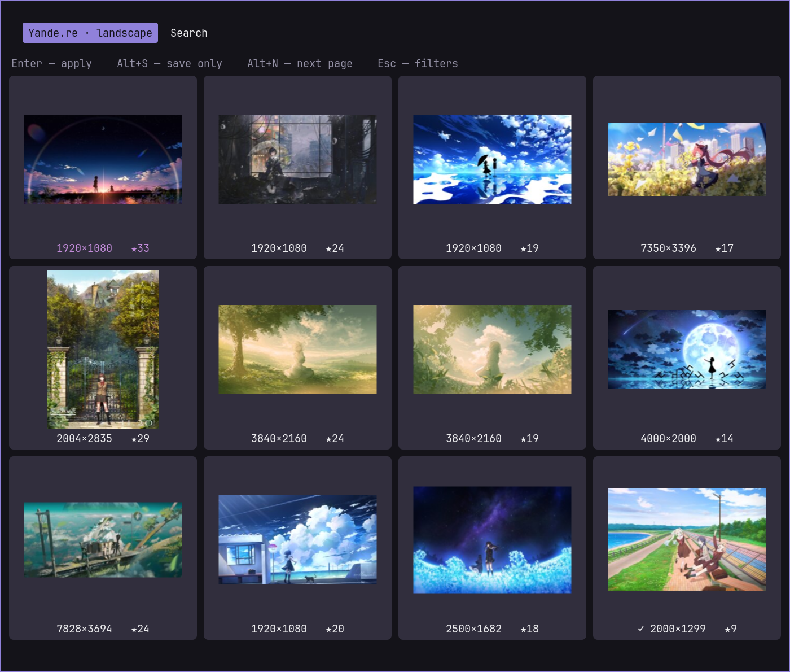

<p align="center">
  <b>🇬🇧 English</b> | <a href="README.ru.md">🇷🇺 Русский</a>
</p>

<div align="center">

# 🗡️ bspwm-dotfiles

**A lightweight bspwm setup for CachyOS: wallpaper-driven colors, a live Polybar,
rofi applets, and Anime Wall — search and download anime art from Yande.re,
Konachan, Danbooru, and Gelbooru.**

[](https://archlinux.org/)
[](https://cachyos.org/)
[](https://github.com/baskerville/bspwm)
[](LICENSE)

&ensp;[<kbd> <br> Installation <br> </kbd>](#-installation)&ensp;
&ensp;[<kbd> <br> Features <br> </kbd>](#-features)&ensp;
&ensp;[<kbd> <br> Screenshots <br> </kbd>](#-screenshots)&ensp;
&ensp;[<kbd> <br> Keybindings <br> </kbd>](#-keybindings)&ensp;
&ensp;[<kbd> <br> Wallpapers <br> </kbd>](#-wallpapers-and-palette)&ensp;

<a href="Images/desktop.jpg">
  
</a>

</div>

## 👋 Hello

This is my daily driver on CachyOS: **bspwm + sxhkd**, Polybar, picom, rofi,
dunst, and Alacritty. The configs are made for a laptop with an
**AMD iGPU + NVIDIA** and for everyday work: browser, music, documents,
screenshots, and quick wallpaper browsing.

Everything that can be automated is automated: the palette comes from the
current image, wallpapers are cached at screen size, and the discrete NVIDIA
GPU stays asleep until you ask for it with `prime-run`.

## ✨ Features

### 🎨 Palette from the wallpaper

`config/theme/apply.py` reads the current wallpaper, extracts colors from it,
and recolors **Polybar, Alacritty, dunst, rofi, zathura, the GTK theme, and
bspwm borders**. When you switch wallpapers quickly, only the last image is
applied; the palette is rebuilt once you stop.

Wallpapers are cached at screen size, so switching does not decode the 4K
original every time. You can rebuild the palette manually:

```bash
~/.config/theme/apply.py            # from the current wallpaper
~/.config/theme/apply.py --show     # only print the colors
```

### 🖼️ Anime Wall — art browser

`Ctrl + Alt + A` — or the **Anime Wall** entry in the rofi launcher
(`Super + Space`). A **tag search field** opens right away: type what you want
and press Enter. It searches **Yande.re, Konachan, Danbooru, and Gelbooru**.

- `Enter` starts the search, `Alt + F` opens filters (rating, score, size,
  orientation, sorting), `Alt + P` switches the provider quickly,
  `Alt + Q` quits;
- `Tab` (or `Alt + T`) shows tag suggestions: the unfinished tag is searched
  on the booru, and the post count is shown next to each suggestion. The
  selected tag is inserted into the field, so you can enter several separated
  by spaces (`landscape night`); `Tab` on an empty input shows popular
  tags;
- results are shown as a thumbnail grid — scroll with the mouse or arrow keys.
  While thumbnails are still loading, the status line shows how many are left;
- `Enter` by default **only saves**; `Alt + A` applies the image as the
  wallpaper; `Alt + S` saves without changing the wallpaper. An applied image
  is copied to `~/Images/Wallpaper_desktop`, so you can find it later in the
  wallpaper selector;
- `Alt + N` goes to the next page, `Alt + B` to the previous one, `Alt + G`
  opens a page picker (or lets you type a number), `Alt + R` reloads
  thumbnails that finished loading in the background, `Alt + Q` quits, `Esc`
  goes back to the search. If a page is empty, the browser returns to the
  last page with results;
- already downloaded art is marked with `✓`;
- files are stored in `~/Pictures/kiri-vault/<Provider>/` — each booru has
  its own folder;
- network requests have timeouts, results and thumbnails are cached, and
  downloads run in the background — the interface does not freeze even if the
  server is unavailable.

<a href="Images/anime-wall.png">
  
</a>

### 🚀 Fastfetch with Asuna

The logo is not a static image but **ANSI art rendered to fit the terminal
size**. It uses half-blocks with gradients and braille dots along the
silhouette edges, so the face and hair stay sharp. The art shrinks
automatically so the module list does not wrap, and disappears on very narrow
terminals.

A **`Screen`** module also shows the current monitor refresh rate. The
generated art is cached in `~/.cache/fastfetch`, so startup is instant.

### 🧩 Rofi applets

Everything is controlled from rofi: wallpapers, network, Bluetooth,
clipboard, screenshots, audio, microphone, power, keyboard layout, and the
keybinding cheat sheet. Rofi themes are recolored together with the rest of
the interface.

### 📊 Polybar

bspwm desktops, CPU, memory, temperature, GPU, now-playing, weather, battery,
volume, network, keyboard layout, and clock. `polybar-gpu` does not query
`nvidia-smi` while the GPU is asleep; otherwise it would wake up every few
seconds.

### 🎮 NVIDIA runtime PM

The installer drops in `nvidia-pm.conf`, udev rules, and enables NVIDIA
services if the system has a GPU. At idle, `runtime_status` should be
`suspended`. To run something on the discrete GPU:

```bash
prime-run <command>
```

### 🎙️ Whisper and media

`Super + D` — voice typing, `Super + Shift + D` — lecture recording. Whisper
models are not stored in git; `./install.sh --with-whisper` downloads them.
Media keys work through `playerctl` with an `mpd` fallback.

## 📸 Screenshots

| Fastfetch | Cava |
|:---:|:---:|
|  |  |

Lock screen — [`Images/Wallpaper_lockscreen/lock_screen.png`](Images/Wallpaper_lockscreen/lock_screen.png).

## 🛠 Installation

```bash
git clone https://github.com/Kir1ght/bspwm-dotfiles.git
cd bspwm-dotfiles
./install.sh --dry-run   # see the plan
./install.sh
```

One command:

```bash
curl -fsSL https://raw.githubusercontent.com/Kir1ght/bspwm-dotfiles/main/bootstrap.sh | bash
```

`install.sh` targets **Arch Linux and CachyOS**. Run it as a regular user; it
will ask for sudo itself. Old configs are moved to `~/.dotfiles-backup-*`
before copying.

| Flag | What it does |
|---|---|
| `--no-packages` | do not install packages |
| `--no-config` | do not copy configs |
| `--no-gpu` | do not touch NVIDIA |
| `--no-firefox` | do not touch the Firefox profile |
| `--no-update` | do not run `pacman -Syu` |
| `--with-whisper` | download whisper.cpp models |
| `--with-apps` | install optional applications |
| `--with-extra` | AUR tools, themes, and `ly` |

`Builder/install.py` does the same through a menu.

## ⌨️ Keybindings

`Super` is Win. The full cheat sheet is `Super + Shift + /`, generated from
`sxhkdrc`.

| Shortcut | Action |
|---|---|
| `Super + T` / `W` / `E` | terminal, Firefox, Thunar |
| `Super + Space` | rofi |
| `Super + Q` | close the focused window |
| `Super + 1…9` | switch desktop |
| `Super + Shift + 1…9` | send the window to a desktop |
| `Super + H/J/K/L` | move focus |
| `Super + Shift + H/J/K/L` | swap windows |
| `Super + Ctrl + H/J/K/L` | resize the window |
| `Super + Ctrl + T` | pseudo-tiling: keep size / return to a normal tile |
| `Alt + Shift` | us/ru layout |
| `Ctrl + Shift + T` | random wallpaper |
| `Ctrl + Alt + T` | choose a wallpaper |
| `Ctrl + Alt + L` | choose a lock screen wallpaper |
| `Ctrl + Alt + A` | Anime Wall: search and download art |
| `Ctrl + Alt + R` | rebuild the palette |
| `Print` | area screenshot |
| `Ctrl + Shift + L` | lock the screen |
| `Super + S` | turn off the display after 2 seconds |
| `Super + D` / `Super + Shift + D` | Whisper: typing, lecture recording |
| `Super + Shift + U` | touchpad: toggle auto-disable while a mouse is connected |

Media keys and Fn brightness keys are also bound in sxhkd.

The `us/ru` layout is configured once per X session in `bspwmrc` (and in
`xinitrc` for startx): `setxkbmap -layout us,ru -option grp:alt_shift_toggle`.
Restarting `bspwmrc` does not reset the active layout. If `Alt + Shift` does
not work, make sure the `xorg-setxkbmap` package is installed.

## 🖼️ Wallpapers and palette

A fresh install uses `Wallpaper_desktop/default.png` until you choose another
wallpaper. After that, bspwm restores the last image from `~/.fehbg`.

Wallpapers are split into two libraries; the scripts scan no other folders:

```text
~/Images/Wallpaper_desktop/      desktop
~/Images/Wallpaper_lockscreen/   lock screen
```

```bash
~/bin/random_wallpaper              # random desktop wallpaper
~/bin/random_wallpaper --set PATH   # a specific image
~/bin/random_wallpaper --lockscreen # random lock screen wallpaper
~/bin/random_wallpaper --set PATH --lockscreen
~/bin/random_wallpaper --cache-all  # rebuild the thumbnail cache
~/bin/select-wallpaper              # rofi selector with previews
~/bin/select-wallpaper --lockscreen # lock screen wallpaper selector
```

`select-wallpaper` (`Ctrl + Alt + T`) shows a thumbnail grid instead of a list
of names. `Enter` applies the selection, `Alt + V` opens the image fullscreen
(close with `q`), `Alt + L` switches between the desktop and lock screen,
`Esc` cancels. A separate shortcut, `Ctrl + Alt + L`, opens the lock screen
selector directly. Previews are cached in
`~/.cache/select-wallpaper/thumbs`, so reopening is almost instant. After
editing `sxhkdrc` manually, reload the hotkeys with
`pkill -USR1 -x sxhkd`; otherwise new shortcuts only work after logging in.

The regular selector shows only `Wallpaper_desktop`. The lock screen selector
shows `Wallpaper_lockscreen` first, then desktop wallpapers marked
`desktop/`. If you choose a desktop image, it is copied to
`Wallpaper_lockscreen` and applied to the lock screen immediately. Other
folders, including `~/Downloads`, are not mixed into the grid.

You can put a new image into the right library or apply it directly:

```bash
~/bin/random_wallpaper --set ~/Downloads/new.png
~/bin/random_wallpaper --set ~/Downloads/lock.png --lockscreen
```

`random_wallpaper --set` imports the file into the matching library: from
`Downloads`/`/tmp` it is **moved**, from other places it is copied. An
identical file is not duplicated, and if the name matches a different file,
`name-2.png` is created. After import, the file is found by the normal folder
scan — there are no downloaded-image lists.

`~/.current_wallpaper` and `~/.current_lockscreen` are stable symlinks to the
current source files. `random_wallpaper` updates them atomically;
`screen-lock` reads `~/.current_lockscreen` (with a fallback to the first file
in `Wallpaper_lockscreen`). `~/.fehbg` still stores an on-screen copy of the
desktop for fast restore at login, and the palette is built from it. Changing
the lock screen wallpaper does not affect the palette.

Art applied from Anime Wall (`Alt + A`) is automatically copied to
`~/Images/Wallpaper_desktop` — the same library the selector browses — so you
can pick it later.

### Anime Wall in the terminal

`anime-wall` also has a regular CLI, handy for scripts and bulk downloads:

```bash
# print results as JSON
anime-wall -p yandere -t 'asuna_(sword_art_online)' --print

# download four landscapes from Konachan
anime-wall -p konachan -t landscape -n 8 --download 4

# Gelbooru with a score filter
anime-wall -p gelbooru -t landscape --min-score 10
```

Settings and API keys live in `~/.config/anime-wall/config.ini` (mode `600`).
Yande.re and Konachan work without keys. **Gelbooru** requires `api_key` and
`user_id`; you can enter them directly in the menu
(`Gelbooru credentials…`), and the file updates itself. **Danbooru** is
sometimes blocked by Cloudflare: if the API returns 403/503, open the site in
Firefox or wait — Anime Wall will show an error and will not hang.

`--download` stores files in the same place,
`~/Pictures/kiri-vault/<Provider>/`. If you only want to build a collection,
leave `on_enter = save` — that is the default.

## 🌦️ Weather

The module gets the temperature from wttr.in. You can set the city in
`~/.config/weather-city` as a line like `City,CC`. There is no file in the
repo; by default the city is detected by IP. If wttr.in confuses places with
the same name, add the country code.

## 🖱️ Touchpad and mouse

While any mouse is connected (USB, Bluetooth, dongle), the touchpad is
**intentionally disabled**. Remove the mouse — the touchpad comes back after
about 2 seconds. This keeps your palm from touching the touchpad while using
the mouse.

This is not a bug. Check the state:

```bash
xinput list-props "$(xinput list --name-only | grep -i touchpad)" | grep 'Device Enabled'
```

`0` — disabled (mouse connected), `1` — enabled.

Toggle:

```bash
touchpad-autoswitch on      # automation on (default)
touchpad-autoswitch off     # touchpad always on
touchpad-autoswitch toggle  # flip the current state
touchpad-autoswitch status  # print the current state
```

Keyboard shortcut — `Super + Shift + U`.

The state is stored in `~/.local/state/touchpad-when-mouse.off`: if the file
exists, automation is disabled. Daemon log:
`~/.local/state/touchpad-when-mouse.log`.

Devices are matched by the `touchpad` substring, so nothing needs to change
on another machine. The touchpad's internal "Mouse" interface (it has the
same name as the touchpad) and virtual pointers are ignored. A disabled
touchpad shows up in `xinput` as `floating slave` with a `∼` prefix — the
daemon accounts for that; otherwise it could not re-enable the touchpad.

### 🖐️ Gestures

Gestures work through `touchegg` (X11 only). The installer enables the
`touchegg.service` daemon; the client is started from `bspwmrc`.

| Gesture | Action |
|---|---|
| 3 fingers left / right | next / previous desktop |
| 3 fingers up / down | focus up / down in the layout |
| 4 fingers left / right | move the window to the next / previous desktop |
| 4 fingers up | fullscreen |
| 4 fingers down | floating mode |

Directions are "natural": swipe left goes forward, right goes back. Gestures
are touchpad-only: a mouse or its dongle cannot trigger them. If a mouse is
connected and the touchpad is disabled by automation, gestures do not work —
that is expected. Enable the touchpad: `Super + Shift + U` or
`touchpad-autoswitch off`.

Config: `~/.config/touchegg/touchegg.conf`. After editing, restart the client:
`pkill -f '[t]ouchegg$'` and log in again (or run `touchegg` from a terminal).

### 🪟 Niri-style layout

bspwm has no drag-to-split: if you drag a tiled window onto another, they
simply swap. You can get the same result from the keyboard:

1. `Super + Alt + M` — mark the window you want to move.
2. Focus the target window with the usual focus keys.
3. `Super + Alt + H/J/K/L` — choose a half of the target:
   left / bottom / top / right.
4. `Super + Alt + Enter` — insert the marked window into that half.
5. `Super + Alt + C` — cancel the selected half.

Example: mark a small window, focus the large window on the left, press
`Super + Alt + K` (top half), then `Super + Alt + Enter`. The large window's
area is split: the small window takes the top half, the large one the bottom
half.

Script: `~/.local/bin/bspwm-split` (also supports `status` and `--help`).

## 📝 Notes

- Arch/CachyOS and X11 only; Wayland is not supported.
- `hz-toggle` and `dual_monitors.sh` are tied to specific hardware. On another
  machine, check `xrandr --query` first.
- Whisper models are not stored in git; `--with-whisper` downloads them.
- picom starts with profile `1.conf`. If you enable the second profile,
  screenshots still will not be blurred: `slop` is in the exceptions.
- Throne gets `CAP_NET_ADMIN` through a pacman hook, so TUN works without
  root prompts after updates.
- The `Dynamic` GTK theme is a recolored copy of Dracula. Open windows pick up
  the colors after a restart.
- `ly` is installed only with `--with-extra`.
- `v2raya-bin` (v2rayA) together with the `xray` core and `upscayl-bin`
  (Upscayl) are installed by default. The v2rayA service is enabled
  separately: `sudo systemctl enable --now v2raya`.
- `anime-wall` uses only the Python standard library; fastfetch's ANSI art
  needs `python-pillow`.

## 📂 Structure

```text
bin/          scripts (~/.local/bin)
config/       contents of ~/.config
system/       udev, modprobe, pacman-hook
themes/       Dracula and its variants
Images/       screenshots and wallpaper libraries (Wallpaper_desktop/lockscreen)
install.sh    installer
bootstrap.sh  clone + install
```

## 📄 License

MIT. See [LICENSE](LICENSE).
