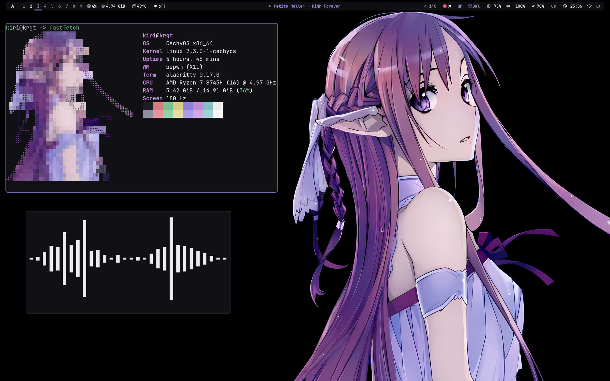
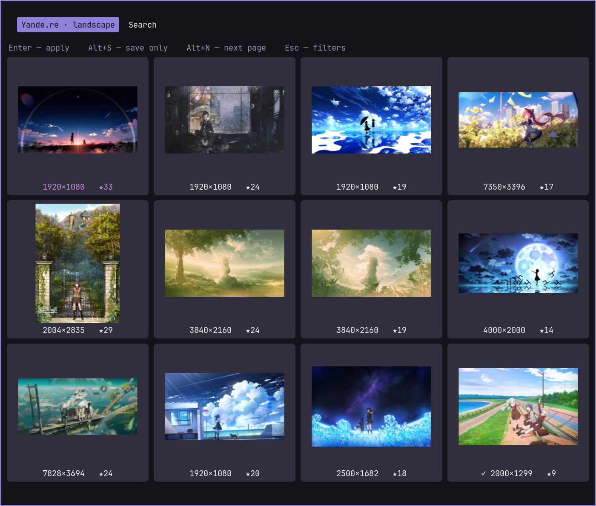
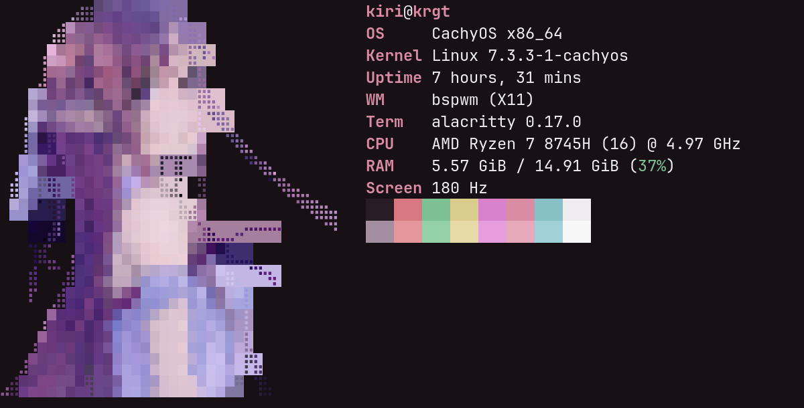
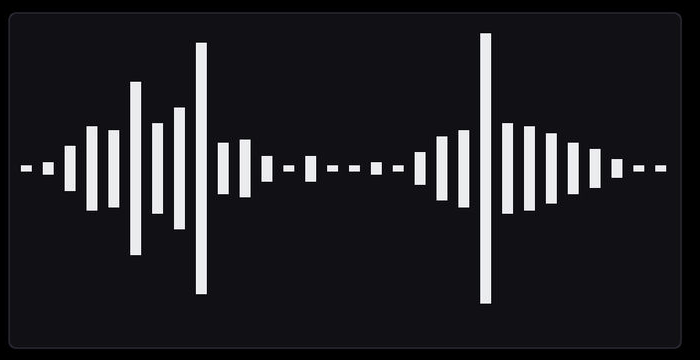

<div align="center">

# 🗡️ bspwm-dotfiles

**Лёгкий bspwm на CachyOS: палитра из обоев, живой Polybar, rofi-апплеты
и Anime Wall — поиск и скачивание аниме-артов с Yande.re, Konachan,
Danbooru и Gelbooru.**

[](https://archlinux.org/)
[](https://cachyos.org/)
[](https://github.com/baskerville/bspwm)
[](LICENSE)

&ensp;[<kbd> <br> Установка <br> </kbd>](#-установка)&ensp;
&ensp;[<kbd> <br> Возможности <br> </kbd>](#-возможности)&ensp;
&ensp;[<kbd> <br> Скриншоты <br> </kbd>](#-скриншоты)&ensp;
&ensp;[<kbd> <br> Клавиши <br> </kbd>](#-клавиши)&ensp;
&ensp;[<kbd> <br> Обои <br> </kbd>](#-обои-и-палитра)&ensp;

<a href="Images/desktop.jpg">
  
</a>

</div>

## 👋 Привет

Это мой повседневный рабочий стол на CachyOS: **bspwm + sxhkd**, Polybar,
picom, rofi, dunst и Alacritty. Конфиги собраны под ноутбук с
**AMD iGPU + NVIDIA** и под обычную работу: браузер, музыка, документы,
скриншоты и быстрый перебор обоев.

Всё, что можно автоматизировать, автоматизировано: палитра берётся из
текущей картинки, обои кэшируются под размер экрана, а дискретная NVIDIA
спит, пока её не попросят через `prime-run`.

## ✨ Возможности

### 🎨 Палитра из обоев

`config/theme/apply.py` читает текущие обои, вытаскивает из них цвета и
перекрашивает **Polybar, Alacritty, dunst, rofi, zathura, GTK-тему и рамки
bspwm**. При быстром переборе применяется только последняя картинка, а
палитра пересобирается один раз, когда вы остановились.

Обои кэшируются в размере экрана, поэтому переключение не декодирует
4K-оригинал каждый раз. Палитру можно пересобрать вручную:

```bash
~/.config/theme/apply.py            # по текущим обоям
~/.config/theme/apply.py --show     # только показать цвета
```

### 🖼️ Anime Wall — браузер артов

`Ctrl + Alt + A` — или пункт **Anime Wall** в rofi-лаунчере (`Super + Space`).
Открывается **поисковая строка для тегов** — сразу можно вбить, что ищешь,
и нажать Enter. Ищет по **Yande.re, Konachan, Danbooru и Gelbooru**.

- `Enter` начинает поиск, `Alt + F` — фильтры (рейтинг, score, размер,
  ориентация, сортировка), `Alt + P` — быстрая смена провайдера,
  `Alt + Q` — выход;
- `Tab` (или `Alt + T`) — подсказки тегов: недописанный тег ищется на
  буру, рядом с каждым показывается число постов. Выбранный тег
  подставляется в строку, так что можно набрать несколько через пробел
  (`blue_archive landscape`); `Tab` на пустом вводе показывает популярные
  теги;
- результаты показываются сеткой превью — можно спокойно скроллить мышью
  или стрелками;
- `Enter` по умолчанию **только сохраняет**; `Alt + A` — применить как обои;
  `Alt + S` — сохранить без смены обоев. Применённый арт копируется
  в `~/Images/Wallpaper_desktop`, поэтому его потом можно найти в селекторе
  обоев;
- `Alt + N` — следующая страница, `Alt + B` — предыдущая, `Alt + G` —
  выбрать страницу из списка (или ввести номер), `Alt + Q` — выйти,
  `Esc` — обратно к поиску. Если страница пустая, браузер сам вернёт
  на последнюю с результатами;
- уже скачанные арты помечаются `✓`;
- файлы лежат в `~/Pictures/kiri-vault/<Провайдер>/` — у каждого бора
  своя папка;
- сеть ограничена таймаутами, результаты и превью кэшируются, скачивание
  идёт в фоне — интерфейс не замирает, даже если сервер недоступен.

<a href="Images/anime-wall.png">
  
</a>

### 🚀 Fastfetch с Асной

Логотип — не статичная картинка, а **ANSI-арт, который рендерится под размер
терминала**. Внутри используются полублоки с градиентами, а по краям силуэта
— брайль-точки, поэтому лицо и волосы остаются чёткими. Арт автоматически
уменьшается, чтобы список модулей не переносился, и исчезает на слишком
узком терминале.

Дополнительно показывается модуль **`Screen`** с текущей герцовкой монитора.
Готовый арт кэшируется в `~/.cache/fastfetch`, так что запуск мгновенный.

### 🧩 Rofi-апплеты

Всё управление собрано в rofi: обои, сеть, Bluetooth, буфер обмена,
скриншоты, звук, микрофон, питание, раскладка и шпаргалка по клавишам.
Темы rofi перекрашиваются вместе с остальным интерфейсом.

### 📊 Polybar

Столы bspwm, CPU, память, температура, GPU, now-playing, погода, батарея,
звук, сеть, раскладка и часы. `polybar-gpu` не опрашивает `nvidia-smi`,
пока карта спит, иначе она бы просыпалась каждые несколько секунд.

### 🎮 NVIDIA runtime PM

Установщик кладёт `nvidia-pm.conf`, udev-правила и включает сервисы NVIDIA,
если в системе есть карта. В простое `runtime_status` должен быть
`suspended`. Запуск на дискретной карте:

```bash
prime-run <команда>
```

### 🎙️ Whisper и медиа

`Super + D` — голосовой ввод, `Super + Shift + D` — запись лекции.
Модели Whisper не лежат в git, их скачивает `./install.sh --with-whisper`.
Медиа-клавиши работают через `playerctl` с запасным вариантом на `mpd`.

## 📸 Скриншоты

| Fastfetch | Cava |
|:---:|:---:|
|  |  |

Экран блокировки — [`Images/Wallpaper_lockscreen/lock_screen.png`](Images/Wallpaper_lockscreen/lock_screen.png).

## 🛠 Установка

```bash
git clone https://github.com/Kir1ght/bspwm-dotfiles.git
cd bspwm-dotfiles
./install.sh --dry-run   # посмотреть план
./install.sh
```

Одной командой:

```bash
curl -fsSL https://raw.githubusercontent.com/Kir1ght/bspwm-dotfiles/main/bootstrap.sh | bash
```

`install.sh` рассчитан на **Arch Linux и CachyOS**. Запускать его нужно от
обычного пользователя, sudo он спросит сам. Старые конфиги перед копированием
складываются в `~/.dotfiles-backup-*`.

| Флаг | Что делает |
|---|---|
| `--no-packages` | не ставить пакеты |
| `--no-config` | не копировать конфиги |
| `--no-gpu` | не трогать NVIDIA |
| `--no-firefox` | не трогать профиль Firefox |
| `--no-update` | не запускать `pacman -Syu` |
| `--with-whisper` | скачать модели whisper.cpp |
| `--with-apps` | поставить дополнительные приложения |
| `--with-extra` | AUR-утилиты, темы и `ly` |

`Builder/install.py` делает то же самое через меню.

## ⌨️ Клавиши

`Super` — это Win. Полная шпаргалка — `Super + Shift + /`, она собирается из
`sxhkdrc`.

| Комбинация | Действие |
|---|---|
| `Super + T` / `W` / `E` | терминал, Firefox, Thunar |
| `Super + Space` | rofi |
| `Super + Q` | закрыть окно |
| `Super + 1…9` | рабочий стол |
| `Super + Shift + 1…9` | отправить окно на стол |
| `Super + H/J/K/L` | фокус |
| `Super + Shift + H/J/K/L` | поменять окна местами |
| `Super + Ctrl + H/J/K/L` | размер окна |
| `Alt + Shift` | раскладка us/ru |
| `Ctrl + Shift + T` | случайные обои |
| `Ctrl + Alt + T` | выбрать обои |
| `Ctrl + Alt + L` | выбрать обои экрана блокировки |
| `Ctrl + Alt + A` | Anime Wall: поиск и скачивание артов |
| `Ctrl + Alt + R` | пересобрать палитру |
| `Print` | скриншот области |
| `Ctrl + Shift + L` | заблокировать экран |
| `Super + S` | выключить экран через 2 секунды |
| `Super + D` / `Super + Shift + D` | Whisper: ввод, запись лекции |

Медиа-клавиши и Fn-клавиши яркости тоже привязаны в sxhkd.

Раскладка `us/ru` настраивается один раз за X-сессию в `bspwmrc` (и в
`xinitrc` для startx): `setxkbmap -layout us,ru -option grp:alt_shift_toggle`.
Перезапуск `bspwmrc` активную раскладку не сбрасывает. Если `Alt + Shift` не
работает, проверьте, что установлен пакет `xorg-setxkbmap`.

## 🖼️ Обои и палитра

На чистой установке ставится `Wallpaper_desktop/default.png`, пока вы не выберете
другие обои. Дальше bspwm восстанавливает последнюю картинку из `~/.fehbg`.

Обои разделены на две библиотеки — других папок скрипты не сканируют:

```text
~/Images/Wallpaper_desktop/      рабочий стол
~/Images/Wallpaper_lockscreen/   экран блокировки
```

```bash
~/bin/random_wallpaper              # случайные обои рабочего стола
~/bin/random_wallpaper --set PATH   # конкретная картинка
~/bin/random_wallpaper --lockscreen # случайные обои локскрина
~/bin/random_wallpaper --set PATH --lockscreen
~/bin/random_wallpaper --cache-all  # пересобрать кэш превью
~/bin/select-wallpaper              # rofi-селектор с превью
~/bin/select-wallpaper --lockscreen # селектор обоев локскрина
```

`select-wallpaper` (`Ctrl + Alt + T`) показывает сетку миниатюр, а не список
имён. `Enter` применяет выбранное, `Alt + V` открывает картинку на весь экран
(закрыть — `q`), `Alt + L` переключает между рабочим столом и локскрином,
`Esc` отменяет. Отдельная комбинация `Ctrl + Alt + L` сразу открывает селектор
локскрина. Превью кэшируются в `~/.cache/select-wallpaper/thumbs`, поэтому
повторное открытие почти мгновенное. После ручного изменения `sxhkdrc`
перезагрузите горячие клавиши командой `pkill -USR1 -x sxhkd` — иначе новые
комбинации начнут работать только после входа в систему.

Обычный селектор показывает только `Wallpaper_desktop`. Селектор локскрина
сначала показывает `Wallpaper_lockscreen`, а ниже — обои из
`Wallpaper_desktop` с пометкой `desktop/`. Если выбрать desktop-картинку,
она копируется в `Wallpaper_lockscreen` и сразу применяется к экрану
блокировки. Другие папки, включая `~/Downloads`, в сетку не подмешиваются.

Новую картинку можно положить в нужную библиотеку или применить напрямую:

```bash
~/bin/random_wallpaper --set ~/Downloads/new.png
~/bin/random_wallpaper --set ~/Downloads/lock.png --lockscreen
```

`random_wallpaper --set` импортирует файл в соответствующую библиотеку:
из `Downloads`/`/tmp` он **перемещается**, из остальных мест копируется.
Одинаковый файл не дублируется, а при совпадении имени с другим содержимым
создаётся `имя-2.png`. После импорта файл находится обычным сканированием
папки — никаких списков скачанных картинок нет.

`~/.current_wallpaper` и `~/.current_lockscreen` — стабильные симлинки на
текущие исходники. `random_wallpaper` обновляет их атомарно; `screen-lock`
читает именно `~/.current_lockscreen` (с запасным вариантом — первый файл
из `Wallpaper_lockscreen`). `~/.fehbg` по-прежнему хранит экранную копию
рабочего стола для быстрого восстановления при входе, а палитра строится
из неё. Смена обоев локскрина палитру не трогает.

Арты, применённые из Anime Wall (`Alt + A`), автоматически копируются
в `~/Images/Wallpaper_desktop` — в ту же библиотеку, которую листает
селектор, поэтому их можно выбрать потом.

### Anime Wall в терминале

У `anime-wall` есть и обычный CLI — удобно для скриптов и массового
скачивания:

```bash
# показать результаты JSON-ом
anime-wall -p yandere -t 'asuna_(sword_art_online)' --print

# скачать четыре пейзажа с Konachan
anime-wall -p konachan -t landscape -n 8 --download 4

# Gelbooru с фильтром по score
anime-wall -p gelbooru -t landscape --min-score 10
```

Настройки и API-ключи лежат в `~/.config/anime-wall/config.ini` (права
`600`). Yande.re и Konachan работают без ключей. **Gelbooru** требует
`api_key` и `user_id` — их можно ввести прямо в меню (`Gelbooru credentials…`),
и файл обновится сам. **Danbooru** иногда закрыт Cloudflare: если API
отвечает 403/503, откройте сайт в Firefox или подождите — Anime Wall
покажет ошибку и не зависнет.

`--download` складывает файлы туда же, в
`~/Pictures/kiri-vault/<Провайдер>/`. Если хочется только собирать
коллекцию, оставьте `on_enter = save` — это значение по умолчанию.

## 🌦️ Погода

Модуль берёт температуру с wttr.in. Город можно задать в
`~/.config/weather-city` строкой вида `Город,CC`. Файла в репозитории нет,
по умолчанию город определяется по IP. Если wttr.in путает одноимённые
места, допишите страну.

## 📝 Мелочи

- Только Arch/CachyOS и X11, Wayland не поддерживается.
- `hz-toggle` и `dual_monitors.sh` завязаны на конкретное железо. На другой
  машине сначала посмотрите `xrandr --query`.
- Модели Whisper не лежат в git, их скачивает `--with-whisper`.
- picom запускается с профилем `1.conf`. Если включить второй профиль,
  скриншоты всё равно не будут размываться: `slop` есть в исключениях.
- Throne получает `CAP_NET_ADMIN` через pacman-hook, поэтому TUN работает
  без запросов root после обновлений.
- GTK-тема `Dynamic` — перекрашенная копия Dracula. Открытые окна подхватят
  цвета после перезапуска.
- `ly` ставится только с `--with-extra`.
- `v2raya-bin` (v2rayA) вместе с ядром `xray` и `upscayl-bin` (Upscayl)
  ставятся по умолчанию. Сервис v2rayA включается отдельно:
  `sudo systemctl enable --now v2raya`.
- `anime-wall` использует только стандартную библиотеку Python; для
  ANSI-арта fastfetch нужен `python-pillow`.

## 📂 Структура

```text
bin/          скрипты (~/.local/bin)
config/       содержимое ~/.config
system/       udev, modprobe, pacman-hook
themes/       Dracula и её варианты
Images/       скриншоты и библиотеки обоев (Wallpaper_desktop/lockscreen)
install.sh    установщик
bootstrap.sh  clone + install
```

## 📄 Лицензия

MIT. См. [LICENSE](LICENSE).