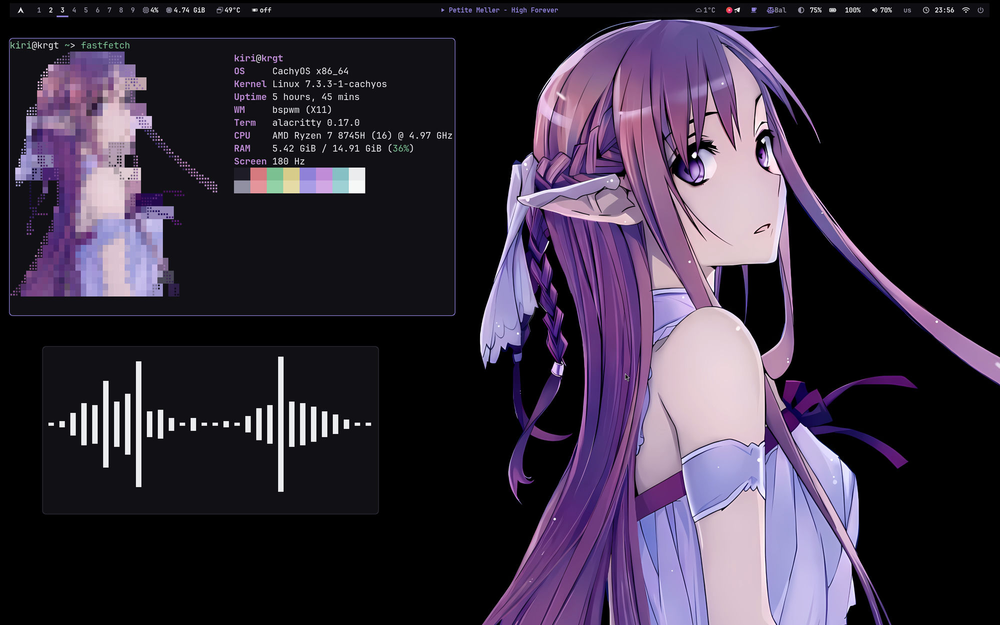
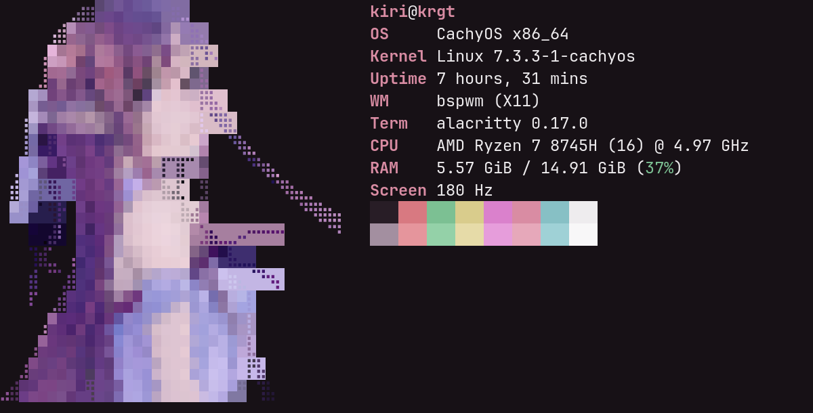
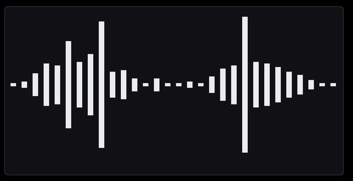

<p align="center">
  <b>🇬🇧 English</b> | <a href="README.ru.md">🇷🇺 Русский</a>
</p>

<div align="center">

# 🗡️ bspwm-dotfiles

**A lightweight bspwm setup for CachyOS: wallpaper-driven colors, a live Polybar,
rofi applets, and Anime Wall — search and download anime art from Yande.re,
Konachan, Danbooru, and Gelbooru.**

[](https://archlinux.org/)
[](https://cachyos.org/)
[](https://github.com/baskerville/bspwm)
[](LICENSE)

&ensp;[<kbd> <br> Installation <br> </kbd>](#-installation)&ensp;
&ensp;[<kbd> <br> Features <br> </kbd>](#-features)&ensp;
&ensp;[<kbd> <br> Screenshots <br> </kbd>](#-screenshots)&ensp;
&ensp;[<kbd> <br> Keybindings <br> </kbd>](#-keybindings)&ensp;
&ensp;[<kbd> <br> Wallpapers <br> </kbd>](#-wallpapers-and-palette)&ensp;

<a href="Images/desktop.jpg">
  
</a>

</div>

## 👋 Hello

This is my daily driver on CachyOS: **bspwm + sxhkd**, Polybar, picom, rofi,
dunst, and Alacritty. The configs are made for a laptop with an
**AMD iGPU + NVIDIA** and for everyday work: browser, music, documents,
screenshots, and quick wallpaper browsing.

Everything that can be automated is automated: the palette comes from the
current image, wallpapers are cached at screen size, and the discrete NVIDIA
GPU stays asleep until you ask for it with `prime-run`.

## ✨ Features

### 🎨 Palette from the wallpaper

`config/theme/apply.py` reads the current wallpaper, extracts colors from it,
and recolors **Polybar, Alacritty, dunst, rofi, zathura, the GTK theme, and
bspwm borders**. When you switch wallpapers quickly, only the last image is
applied; the palette is rebuilt once you stop.

Wallpapers are cached at screen size, so switching does not decode the 4K
original every time. You can rebuild the palette manually:

```bash
~/.config/theme/apply.py            # from the current wallpaper
~/.config/theme/apply.py --show     # only print the colors
```

### 🖼️ Anime Wall — art browser

`Ctrl + Alt + A` — or the **Anime Wall** entry in the rofi launcher
(`Super + Space`). This opens a single GTK4 window for **Yande.re, Konachan,
Danbooru, and Gelbooru**. Pick the provider and enter space-separated tags
(`landscape night`), then click **Search** or press `Enter`. Tag suggestions,
filters and paging are visible controls; `Ctrl + L` returns to the search.

Select an image to see its preview and details. **Download** leaves the
current wallpaper unchanged; **Set wallpaper** applies the art and adds it
to `~/Images/Wallpaper_desktop`. Downloads appear in
`~/Pictures/kiri-vault/<Provider>/` and are marked `✓` in the gallery.
Search, thumbnails and downloads run in the background. The old menu is
still available via `anime-wall --rofi`.

### 🚀 Fastfetch with Asuna

The logo is not a static image but **ANSI art rendered to fit the terminal
size**. It uses half-blocks with gradients and braille dots along the
silhouette edges, so the face and hair stay sharp. The art shrinks
automatically so the module list does not wrap, and disappears on very narrow
terminals.

A **`Screen`** module also shows the current monitor refresh rate. The
generated art is cached in `~/.cache/fastfetch`, so startup is instant.

### 🧩 Rofi applets

Everything is controlled from rofi: wallpapers, network, Bluetooth,
clipboard, screenshots, audio, microphone, power, keyboard layout, and the
keybinding cheat sheet. Rofi themes are recolored together with the rest of
the interface.

### 🔵 Bluetooth

`Super + Ctrl + B` opens `bluetooth-menu`. Devices are listed by their BlueZ
alias, never by a bare MAC address, with state, the active codec and battery
charge. Per device you can connect or disconnect, pair, trust, pick the A2DP
codec (SBC, SBC-XQ, AAC, LDAC, aptX, aptX HD — whatever PipeWire offers for
the connected device), make it the default audio output, or forget it. The
main menu also rescans for devices and switches the adapter on or off.

LDAC is capped at 330 kbps (`mq`) in
`config/wireplumber/wireplumber.conf.d/51-bluetooth.conf`: the MediaTek
MT7922 combo card cannot hold 660 kbps (`sq`) or adaptive `auto` even with
Wi-Fi power save and USB autosuspend disabled. AAC is a clean alternative if
330 kbps LDAC is not enough.

### 📊 Polybar

bspwm desktops, CPU, memory, temperature, GPU, now-playing, weather, battery,
volume, network, keyboard layout, device batteries (wireless mouse and
Bluetooth headset, in one compact label; the mouse warns at 20% and 10%),
and clock. `polybar-gpu` does not query
`nvidia-smi` while the GPU is asleep; otherwise it would wake up every few
seconds.

### 🎮 NVIDIA runtime PM

The installer drops in `nvidia-pm.conf`, udev rules, and enables NVIDIA
services if the system has a GPU. At idle, `runtime_status` should be
`suspended`. To run something on the discrete GPU:

```bash
prime-run <command>
```

### 📽️ Projector / HDMI

The HDMI port is wired to the discrete NVIDIA GPU, while the internal panel
and the X session run on the AMD iGPU. X cannot see the port until the NVIDIA
outputs are attached as a PRIME display-offload sink.

Plug in the cable and press `Super + Shift + O` to mirror the desktop or
turn HDMI off. `hdmi mirror` scales the whole laptop desktop to the external
output; it never moves or fullscreens a window. If a projector shows a
stale frame or rejects scaling, try `hdmi mirror --common`: both displays
use a common mode without a transform. `hdmi off` restores the original
laptop mode. For a separate desktop use `hdmi extend`; the old fullscreen
window workflow is still available as `hdmi-present on --window`.

`hdmi status` shows the connectors; `hdmi-gpu status` distinguishes the
running X server from the policy for the next login. `hdmi-gpu on|off`
changes the iGPU-only override for the next login, only using sudo if a
change is needed. A visible NVIDIA provider doesn't confirm the projector
is connected. If the provider is absent, check the Xorg log and the NVIDIA
module for the running kernel before changing packages. Keeping NVIDIA in
X can cost battery on this laptop.

### 🎙️ Whisper and media

`Super + D` — voice typing, `Super + Shift + D` — lecture recording. Whisper
models are not stored in git; `./install.sh --with-whisper` downloads them.
Media keys work through `playerctl` with an `mpd` fallback. Latin look-alikes
that Whisper drops inside Cyrillic words (`привeт`) are replaced with the
Cyrillic letter before typing.

### 🎵 Lyrics in the terminal

Type `music-tui` in any terminal. A borderless floating window opens and shows
the words being sung, one or two at a time, drawn as large block letters. Nothing
else is drawn — no track name, no hints.

The letters are the real ExtraBold font rendered to pixels and printed as
half-blocks, so they stay smooth and always fit the window. Latin and Cyrillic
use JetBrains Mono, Japanese lyrics use Noto Sans CJK. The window keeps the
terminal's own colours and background, so it matches the rest of the desktop.

Lyrics come from [lrclib.net](https://lrclib.net) and the playback position from
any MPRIS source through `playerctl` (browser, mpv, spotifyd, ncspot), so nothing
needs to be logged in. Font size and window size are constants at the top of
`bin/music-tui`.

Needs `playerctl`, `python-pillow`, `python-fonttools`, the JetBrains Mono fonts
and `noto-fonts-cjk`.

## 📸 Screenshots

| Fastfetch | Cava |
|:---:|:---:|
|  |  |

Lock screen — [`Images/Wallpaper_lockscreen/lock_screen.png`](Images/Wallpaper_lockscreen/lock_screen.png).

## 🛠 Installation

```bash
git clone https://github.com/Kir1ght/bspwm-dotfiles.git
cd bspwm-dotfiles
./install.sh --dry-run   # see the plan
./install.sh
```

One command:

```bash
curl -fsSL https://raw.githubusercontent.com/Kir1ght/bspwm-dotfiles/main/bootstrap.sh | bash
```

`install.sh` targets **Arch Linux and CachyOS**. Run it as a regular user; it
will ask for sudo itself. Old configs are moved to `~/.dotfiles-backup-*`
before copying.

| Flag | What it does |
|---|---|
| `--no-packages` | do not install packages |
| `--no-config` | do not copy configs |
| `--no-gpu` | do not touch NVIDIA |
| `--no-firefox` | do not touch the Firefox profile |
| `--no-update` | do not run `pacman -Syu` |
| `--with-whisper` | download whisper.cpp models |
| `--with-apps` | install optional applications |
| `--with-extra` | AUR tools, themes, and `ly` |

`Builder/install.py` does the same through a menu.

## ⌨️ Keybindings

`Super` is Win. The full cheat sheet is `Super + Shift + /`, generated from
`sxhkdrc`.

| Shortcut | Action |
|---|---|
| `Super + T` / `W` / `E` | terminal, Firefox, Thunar |
| `Super + Space` | rofi |
| `Super + Q` | close the focused window |
| `Super + 1…9` | switch desktop |
| `Super + Shift + 1…9` | send the window to a desktop |
| `Super + H/J/K/L` | move focus |
| `Super + Shift + H/J/K/L` | swap windows |
| `Super + Ctrl + H/J/K/L` | resize the window |
| `Super + Ctrl + T` | pseudo-tiling: keep size / return to a normal tile |
| `Super + A` | floating ↔ tiled (always returns to a tile) |
| `Super + F` | fullscreen ↔ the state it came from |
| `Super + Alt + drag / click` | split: drag onto a half, or click to mark and place |
| `Alt + Shift` | us/ru layout |
| `Ctrl + Shift + T` | random wallpaper |
| `Ctrl + Alt + T` | choose a wallpaper |
| `Ctrl + Alt + L` | choose a lock screen wallpaper |
| `Ctrl + Alt + A` | Anime Wall: search and download art |
| `Ctrl + Alt + R` | rebuild the palette |
| `Print` | area screenshot |
| `Ctrl + Shift + L` | lock the screen |
| `Super + S` | turn off the display after 2 seconds |
| `Super + Alt + S` | wake the panel if it stayed dark |
| `Super + D` / `Super + Shift + D` | Whisper: typing, lecture recording |
| `Super + Ctrl + B` | Bluetooth: connect, codec, pair, forget |
| `Super + Shift + U` | touchpad: toggle auto-disable while a mouse is connected |
| `Super + Shift + O` | projector: toggle HDMI mirroring |

Media keys and Fn brightness keys are also bound in sxhkd.

The `us/ru` layout is configured in `bspwmrc` (and in `xinitrc` for startx):
`setxkbmap -layout us,ru -option grp:alt_shift_toggle`. Restarting `bspwmrc`
does not reset the active layout, because it applies the keymap only when the
loaded one is actually wrong.

A wireless mouse dongle also exposes keyboard devices, and every reconnect
makes Xorg re-apply `/etc/X11/xorg.conf.d/00-keyboard.conf` to each keyboard.
That file must therefore carry both groups; otherwise `ru` disappears
mid-session. `install.sh` sets it with
`localectl set-x11-keymap us,ru pc105 "" grp:alt_shift_toggle`. To fix an
existing install, run the same command with `sudo`; it takes effect after the
next login. `bin/xkb-layout-guard` is the safety net for the current session:
it waits on udev (no polling) and restores the layout after a hotplug.

If `Alt + Shift` still does not work, check:

```bash
setxkbmap -query    # layout: us,ru, options: grp:alt_shift_toggle
xkb-switch -l      # must list us and ru
```

## 🖼️ Wallpapers and palette

A fresh install uses `Wallpaper_desktop/default.png` until you choose another
wallpaper. After that, bspwm restores the last image from `~/.fehbg`.

Wallpapers are split into two libraries; the scripts scan no other folders:

```text
~/Images/Wallpaper_desktop/      desktop
~/Images/Wallpaper_lockscreen/   lock screen
```

```bash
~/bin/random_wallpaper              # random desktop wallpaper
~/bin/random_wallpaper --set PATH   # a specific image
~/bin/random_wallpaper --lockscreen # random lock screen wallpaper
~/bin/random_wallpaper --set PATH --lockscreen
~/bin/random_wallpaper --cache-all  # rebuild the thumbnail cache
~/bin/select-wallpaper              # rofi selector with previews
~/bin/select-wallpaper --lockscreen # lock screen wallpaper selector
```

`select-wallpaper` (`Ctrl + Alt + T`) shows a thumbnail grid instead of a list
of names. `Enter` applies the selection, `Alt + V` opens the image fullscreen
(close with `q`), `Alt + L` switches between the desktop and lock screen,
`Esc` cancels. A separate shortcut, `Ctrl + Alt + L`, opens the lock screen
selector directly. Previews are cached in
`~/.cache/select-wallpaper/thumbs`, so reopening is almost instant. After
editing `sxhkdrc` manually, reload the hotkeys with
`pkill -USR1 -x sxhkd`; otherwise new shortcuts only work after logging in.

The regular selector shows only `Wallpaper_desktop`. The lock screen selector
shows `Wallpaper_lockscreen` first, then desktop wallpapers marked
`desktop/`. If you choose a desktop image, it is copied to
`Wallpaper_lockscreen` and applied to the lock screen immediately. Other
folders, including `~/Downloads`, are not mixed into the grid.

You can put a new image into the right library or apply it directly:

```bash
~/bin/random_wallpaper --set ~/Downloads/new.png
~/bin/random_wallpaper --set ~/Downloads/lock.png --lockscreen
```

`random_wallpaper --set` imports the file into the matching library: from
`Downloads`/`/tmp` it is **moved**, from other places it is copied. An
identical file is not duplicated, and if the name matches a different file,
`name-2.png` is created. After import, the file is found by the normal folder
scan — there are no downloaded-image lists.

`~/.current_wallpaper` and `~/.current_lockscreen` are stable symlinks to the
current source files. `random_wallpaper` updates them atomically;
`screen-lock` reads `~/.current_lockscreen` (with a fallback to the first file
in `Wallpaper_lockscreen`). `~/.fehbg` references the screen-sized copy for
fast restore; the palette follows `~/.current_wallpaper`. Changing the lock
screen wallpaper does not affect the palette.

Art applied from Anime Wall (**Set wallpaper**) is automatically copied to
`~/Images/Wallpaper_desktop` — the same library the selector browses — so you
can pick it later.

### Anime Wall in the terminal

`anime-wall` also has a regular CLI, handy for scripts and bulk downloads:

```bash
# print results as JSON
anime-wall -p yandere -t 'asuna_(sword_art_online)' --print

# download four landscapes from Konachan
anime-wall -p konachan -t landscape -n 8 --download 4

# Gelbooru with a score filter
anime-wall -p gelbooru -t landscape --min-score 10
```

Settings and API keys live in `~/.config/anime-wall/config.ini` (mode `600`).
Yande.re and Konachan work without keys. **Gelbooru** requires `api_key` and
`user_id`; you can enter them directly in the menu
(`Gelbooru credentials…`), and the file updates itself. **Danbooru** is
sometimes blocked by Cloudflare: if the API returns 403/503, open the site in
Firefox or wait — Anime Wall will show an error and will not hang.

Search results and previews are cached; older results remain available on
provider errors. Downloads run in the background with a deadline and only
validated images are moved into the vault. If multiple Apply requests are
queued, the last online selection wins. `--download` stores files in the same place,
`~/Pictures/kiri-vault/<Provider>/`. To build a collection without changing
your desktop, use **Download**.

## 🌦️ Weather

The module gets the temperature from wttr.in. You can set the city in
`~/.config/weather-city` as a line like `City,CC`. There is no file in the
repo; by default the city is detected by IP. If wttr.in confuses places with
the same name, add the country code.

## 🖱️ Touchpad and mouse

While any mouse is connected (USB, Bluetooth, dongle), the touchpad is
**intentionally disabled**. Remove the mouse and the touchpad comes back
after a few seconds. This keeps your palm from touching the pad while using
the mouse.

The touchpad exposes two XInput pointer devices with the same hardware name
(`... Mouse` and `... Touchpad`). Both are disabled and enabled together:
disabling only the one matching `touchpad` leaves the companion alive, which
is why the pad used to keep working while a mouse was connected.

This is not a bug. Check the state:

```bash
xinput list --short | grep -iE 'touchpad|uniw|synaptics|elan'
```

`slave pointer` — enabled; `floating slave` — disabled.

Toggle:

```bash
touchpad-autoswitch on      # automation on (default)
touchpad-autoswitch off     # touchpad always on
touchpad-autoswitch toggle  # flip the current state
touchpad-autoswitch status  # print the current state
```

Keyboard shortcut — `Super + Shift + U`.

The state is stored in `~/.local/state/touchpad-when-mouse.off`: if the file
exists, automation is disabled. Daemon log:
`~/.local/state/touchpad-when-mouse.log`.

Devices are grouped by the hardware name prefix before `Mouse` / `Touchpad`,
so nothing needs to change on another machine. Virtual core pointers are
ignored. A disabled device shows up in `xinput` as `floating slave` with a
`∼` prefix; the daemon accounts for that, otherwise it could not re-enable
the pad.

A mouse is detected both through XInput and through the kernel
(`/proc/bus/input/devices`). Wireless dongles can vanish from X for a moment
while the kernel still lists them; the kernel check keeps the pad off during
that window. Absence is debounced (three polls, about six seconds), so a
brief dongle dropout does not switch the pad back on.

### Mouse battery

`vxe-battery` asks the VXE R1 SE+ dongle for the charge over hidraw and
prints `87% (charging)`. `--percent` prints just the number for scripts,
`--json` the full reply. It needs `system/udev/71-vxe-mouse.rules` installed
(`install.sh` does that) so the logged-in user may open the dongle's HID
interface.

### 🖐️ Gestures

Gestures work through `touchegg` (X11 only). The installer enables the
`touchegg.service` system daemon; the per-session client is managed by
`touchpad-when-mouse.sh`, which stops it while a mouse is connected.

| Gesture | Action |
|---|---|
| 3 fingers left / right | next / previous desktop |
| 3 fingers up / down | focus up / down in the layout |
| 4 fingers left / right | move the window to the next / previous desktop |
| 4 fingers up | fullscreen / back to the previous state |
| 4 fingers down | floating ↔ tiled |

Directions are "natural": swipe left goes forward, right goes back. Gestures
are touchpad-only: a mouse or its dongle cannot trigger them. If a mouse is
connected and the touchpad is disabled by automation, gestures do not work —
that is expected. Enable the touchpad: `Super + Shift + U` or
`touchpad-autoswitch off`.

Touchégg reads the touchpad through libinput, so `xinput disable` alone does
not stop gestures: the daemon stops the per-session client as well and starts
it again when the mouse goes away. Only that client is touched — the
`touchegg --daemon` service keeps running. While a mouse is connected the pad
and its gestures accept nothing.

Config: `~/.config/touchegg/touchegg.conf`. After editing, restart the client:
`pkill -f '[t]ouchegg$'` (the daemon starts it again within a couple of
seconds when no mouse is connected), or run `touchegg` from a terminal after
`touchpad-autoswitch off`.

### 🪟 Windows: native bspwm + Niri-style split

Plain `Super` + mouse keeps the normal bspwm behaviour:

| Mouse | Action |
|---|---|
| `Super + left drag` | move a floating window; on tiled windows — swap the two windows (the usual bspwm drag) |
| `Super + middle drag` | resize a tiled window by the border shared with its neighbour |
| `Super + right drag` | resize a tiled window by the nearest corner |

Resizing a tiled window changes a border it shares with a neighbour. A window
that fills the monitor has nothing to resize against: make it pseudo-tiled
(`Super + Ctrl + T`) first, then resize it with the mouse or with
`Super + Ctrl + H/J/K/L`. Windows that report a fixed size (dialogs) keep
that size by design.

`Super + A` and `Super + F` use `~/.local/bin/bspwm-toggle-state` instead of
bspwm's own `~floating` / `~fullscreen`. bspwm's `~STATE` remembers only the
previous state, so after a fullscreen visit `Super + A` would bounce between
floating and fullscreen and never return to the tile. The helper chooses the
target explicitly: floating always goes back to a normal tile, and leaving
fullscreen restores the state the window came from. It behaves the same for
tiled, pseudo-tiled, floating, fullscreen and fixed-size dialog windows. The
4-finger touchpad gestures call the same helper.

Hold **`Super + Alt`** to place windows Niri-style instead of swapping:

- `Super + Alt + drag` — drag a window onto the left, right, top or bottom
  half of another window. The half under the cursor is highlighted and on
  release the window takes that half;
- `Super + Alt + click` on a window — mark it, then `Super + Alt + click`
  the half of another window to place it there. No dragging at all, which is
  much easier on a touchpad. Click the marked window again to unmark it;
- dropping on empty space or on the same window does nothing;
- only one window is marked at a time;
- a floating or pseudo-tiled window can be placed too: it becomes a normal
  tile, so its old floating/pseudo size is dropped. Floating and fullscreen
  windows cannot be *targets*, and a fullscreen window is ignored until you
  leave fullscreen;
- the target is the window under the cursor, so splits work across monitors,
  and the marked window may even live on another desktop;
- on a monocle desktop use the keyboard workflow below: the tree changes
  but nothing is visible until you leave monocle, and the notification says
  so (the mouse cannot target a different window when all of them overlap);
- if the drag is aborted, the preselection is cancelled.

`Super + Z + click` (or any letter plus a mouse button) cannot be bound in
sxhkd: a mouse chord only accepts real modifier keys. `Super + Alt` is used
because it is the same prefix as the keyboard split keys below.

The same result from the keyboard — mark the window to move, focus the
target, and press the half. The window is placed immediately, so there is no
preview to confirm and no extra key to press:

1. `Super + Alt + M` — mark the window you want to move.
2. Focus the target window with the usual focus keys.
3. `Super + Alt + H/J/K/L` — place the marked window into the left / bottom /
   top / right half of the target.
4. `Super + Alt + C` — cancel a pending preselection left over from the mouse
   or a manual `bspc node -p`; the keyboard flow normally never leaves one.

Example: mark a small window, focus the large window on the left, press
`Super + Alt + K` (top half), and the large window's area is split right
away: the small window takes the top half, the large one the bottom half.
Marking a second window drops the mark from the first one, so the marked
window is always the one you marked last.

Scripts: `~/.local/bin/bspwm-drag-split` (mouse and touchpad) and
`~/.local/bin/bspwm-split` (keyboard, also supports `status` and `--help`).

## 🩺 Troubleshooting

### Logged in, but the desktop is empty

`bspwm` runs `~/.config/bspwm/bspwmrc` directly, so the file **must be
executable**. Without the execute bit bspwm skips it *silently*: no wallpaper,
no polybar, no picom, no hotkeys — just a bare screen, so it looks like the
session failed to start. Check and fix:

```bash
ls -l ~/.config/bspwm/bspwmrc     # need -rwxr-xr-x
chmod 755 ~/.config/bspwm/bspwmrc
```

Then log out and back in. Copying configs with `install -m644`, restoring from
a backup, or a `git archive` extraction can all drop the bit. `install.sh`
sets it and aborts if it is missing.

### Black screen after login

The previous session can leave the panel DPMS-off; the text console then
stays black although the machine works, and a reboot may not fix it (the
requested brightness is unchanged, so the driver never re-applies it).
`screen-wake` writes a readable value and clears DPMS. It runs from
`~/.bash_profile` at a text login, from `bspwmrc` when X starts and from
`~/.xinitrc` after bspwm exits; `Super + Alt + S` calls it by hand.

## 📝 Notes

- Arch/CachyOS and X11 only; Wayland is not supported.
- `hz-toggle` and `dual_monitors.sh` are tied to specific hardware. On another
  machine, check `xrandr --query` first.
- Whisper models are not stored in git; `--with-whisper` downloads them.
- picom starts with profile `1.conf`. If you enable the second profile,
  screenshots still will not be blurred: `slop` is in the exceptions.
  The profile animates window open/close and layout changes; comment out the
  `animations` block in `1.conf` and restart picom to turn that off.
- Throne gets `CAP_NET_ADMIN` through a pacman hook, so TUN works without
  root prompts after updates.
- The `Dynamic` GTK theme is a recolored copy of Dracula. Open windows pick up
  the colors after a restart.
- `ly` is installed only with `--with-extra`.
- `v2raya-bin` (v2rayA) together with the `xray` core and `upscayl-bin`
  (Upscayl) are installed by default. The v2rayA service is enabled
  separately: `sudo systemctl enable --now v2raya`.
- `anime-wall` uses `curl`, `python-pillow` and `python-gobject`/GTK4.
  Caffeine holds the X11 saver and DPMS off, then restores the previous
  timers when disabled. KDE Connect starts via the session bus
  when installed; no window or tray indicator is launched.

## 📂 Structure

```text
bin/          scripts (~/.local/bin)
config/       contents of ~/.config
system/       udev, modprobe, pacman-hook
themes/       Dracula and its variants
Images/       screenshots and wallpaper libraries (Wallpaper_desktop/lockscreen)
install.sh    installer
bootstrap.sh  clone + install
```

## 📄 License

MIT. See [LICENSE](LICENSE).
